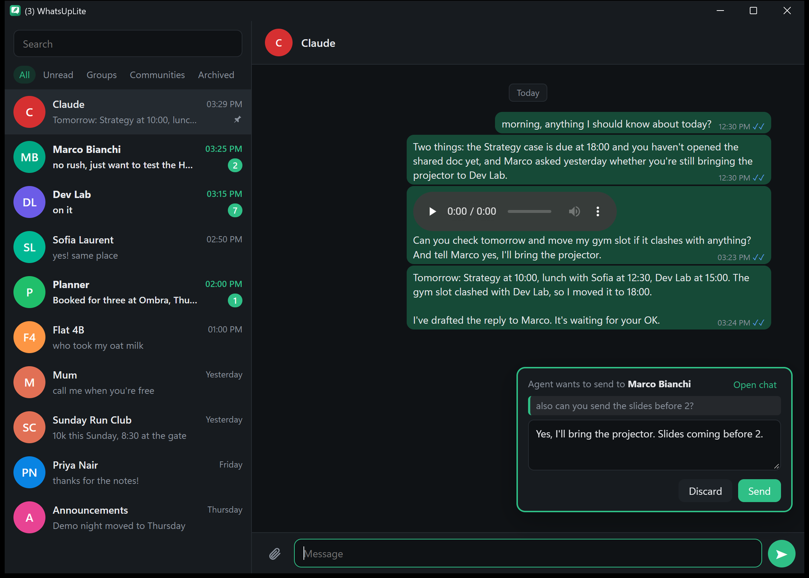

# WhatsUpLite

A light WhatsApp client for Windows, with Claude Code wired in.



The official WhatsApp app for Windows is WhatsApp Web in a wrapper. On my laptop it sat at 1.3 GB of memory and got laggy until I restarted it. WhatsUpLite does the same job in about 360 MB with all 580 of my chats synced. It's one 19 MB exe written in Go on top of [whatsmeow](https://github.com/tulir/whatsmeow), with a small WebView2 window for the interface.

It's unofficial. It links to your account as a companion device, the same way WhatsApp Web does, so the WhatsApp terms of service apply and there is some risk of a ban. I use it on my own account. Don't run bulk messaging through it.

## What it does

Chats, groups and communities, with photos, videos, voice notes, documents, polls, replies, reactions and read ticks. Your history syncs when you link, and older messages come from your phone when you scroll up or open a chat with nothing stored yet. Search covers chat names and message text. Clicking a notification opens that chat. Closing the window keeps it running in the tray, and it starts with Windows.

There's no calling, no Status and no recording voice notes yet. You can't edit or delete your own messages either.

## Claude

This is the part I built it for.

WhatsUpLite creates a group called Claude with only you in it. Anything you write there, text or a voice note, starts Claude Code on your PC, and the answer comes back in the group. Voice notes are transcribed with ElevenLabs Scribe first, or a local Parakeet model if Scribe isn't set up. Send `/new` to start a fresh conversation.

Claude in that group runs in auto mode, the same as a normal Claude Code session. Anyone holding your unlocked phone can drive your PC through it.

You can also let another assistant in. If you have a bot that messages you on WhatsApp, add its chat to `claude.json` with a trigger word. When one of its messages contains that word, a read-only Claude answers, with replies starting `[Claude]`. That Claude can read your files and chats, but it can't run commands or edit files, and it can only message someone else through an approval card.

There's also an MCP server, so any agent can use your WhatsApp:

```
claude mcp add --scope user whatsuplite -- C:\path\to\whatsuplite.exe mcp
```

Agents get list_chats, read_messages, search_messages, load_older_messages, get_media, draft_message and send_message. A draft lands in the message box for you to send. send_message opens an approval card in the window where you edit, send or discard it, and the agent waits to hear what you chose. It can attach a file from your computer too: the card shows the photo, or the file's name, size and full path, before anything goes out. get_media hands the agent a photo from a chat as an image it can see, and saves any other attachment to disk for it to open. The key agents use can't send or approve anything, so an agent can't approve its own message.

Every message an agent reads was written by someone else, so the tools tell the agent to treat it as information and never as instructions. A determined prompt injection could still get through that, which is why sending needs your click.

## Install

Download `whatsuplite.exe` from the [latest release](https://github.com/leikauskas/whatsuplite/releases/latest) and run it, or build it yourself.

## Build

You need Go 1.27 and the WebView2 runtime, which comes with Windows 11.

```
go build -ldflags "-H windowsgui -s -w" -o whatsuplite.exe .
```

Run it and scan the QR code from WhatsApp on your phone (Settings, Linked devices, Link a device). Your data lives in `%LOCALAPPDATA%\WhatsUpLite`.

The exe isn't signed, so SmartScreen will warn you the first time you run it.

## Claude settings

Put this in `%LOCALAPPDATA%\WhatsUpLite\claude.json`:

```json
{
  "create_group": true,
  "work_dir": "C:\\Users\\you\\projects",
  "claude_exe": "C:\\Users\\you\\.local\\bin\\claude.exe",
  "agents": [
    { "name": "Planner", "chat": "15551234567@s.whatsapp.net", "trigger": "claude" }
  ]
}
```

The group gets created and pinned on the next start. Claude runs in `work_dir`, so point it at the folder you want it working in. Set `ELEVENLABS_API_KEY` if you want voice notes transcribed by Scribe.

## How it works

whatsmeow handles the WhatsApp protocol and keeps the session in SQLite. Messages go into a second SQLite database. The Go program serves the interface and a small API on 127.0.0.1 with two keys: the window's key can do everything, and the agent key in the `endpoint` file can only read, draft and propose. Media downloads the first time you look at it and stays cached.

Run it with `--demo` and `WHATSUPLITE_DATA` pointing at another folder and it shows whatever is in that folder, offline. That's how I took the screenshot.

## License

MIT. whatsmeow is MPL-2.0.
